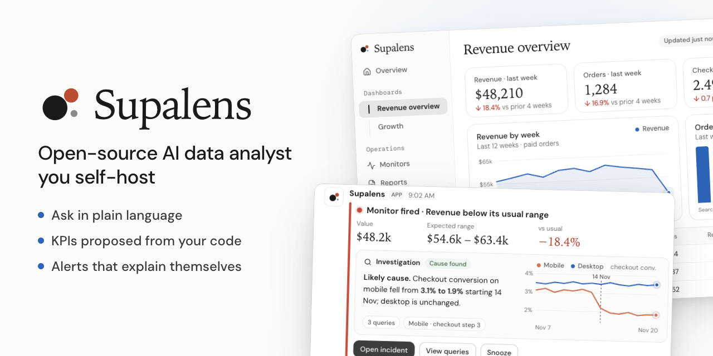
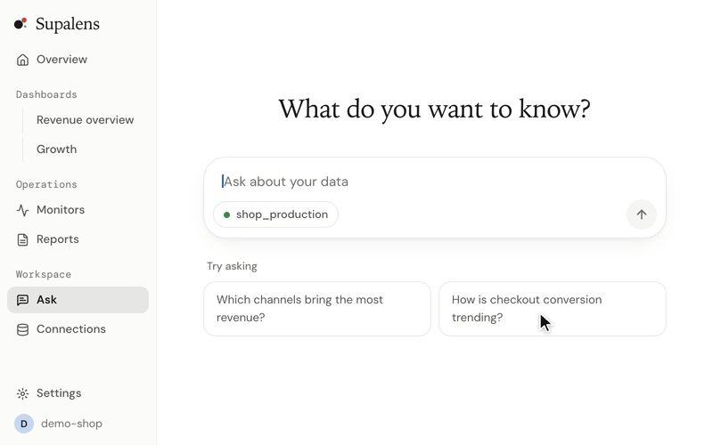

<p align="center">
  
</p>

<h1 align="center">Supalens</h1>

<p align="center">
  <a href="./README.md">English</a> · <a href="./README.ko.md">한국어</a> · <a href="./README.ja.md">日本語</a> · <a href="./README.zh-CN.md">简体中文</a> · <b>Español</b>
</p>

<p align="center">
  <b>Analista de datos con IA, de código abierto, que alojas tú mismo.</b><br>
  Conecta Postgres, pregunta en lenguaje natural y recibe KPI propuestos a partir de tu esquema y tu código;<br>
  después los vigila por ti: cuando una cifra se mueve, investiga y te explica por qué.
</p>

<p align="center">
  <a href="#inicio-rápido">Inicio rápido</a> ·
  <a href="./docs/self-hosting.md">Guía de autoalojamiento (en inglés)</a> ·
  <a href="https://supalens.ai">Versión alojada</a>
</p>

<p align="center">
  <a href="./LICENSE"></a>
  
  
</p>

<p align="center">
  
</p>

## Inicio rápido

```bash
git clone https://github.com/nullarch/supalens.git && cd supalens
./selfhost.sh
```

Solo necesitas **Docker y una clave de API de un modelo de lenguaje**: Anthropic por defecto,
cualquier proveedor compatible con la API de OpenAI, o un modelo que ejecutes tú mismo con Ollama.
Nada más: no hay otra cuenta que crear, no hay telemetría y el navegador nunca llama a terceros. El
script pregunta la dirección y la clave, genera el resto de los secretos y arranca la aplicación con
su propia base de datos. Abre la dirección, crea la cuenta de administrador y conecta una base de
datos.

> El primer arranque compila la imagen de la aplicación en tu máquina y necesita unos 6 GB de
> memoria para Docker. Detalles, actualizaciones y copias de seguridad:
> [docs/self-hosting.md](./docs/self-hosting.md).

## Qué hace

- **Pregunta a tu base de datos.** Las preguntas en lenguaje natural se convierten en SQL legible, un
  gráfico adecuado al resultado y un widget que puedes fijar en un panel.
- **KPI propuestos para ti, y solo los que se ejecutaron.** Supalens lee tu esquema (y tu
  repositorio, si lo vinculas) y propone KPI. Cada propuesta sale de una consulta que realmente se
  ejecutó, así que nada que no funcione llega a la lista.
- **Monitoriza por objetivo, no por umbral.** Describe lo que te importa; redacta la serie diaria y
  la regla, y te muestra cómo se habría comportado esa regla en los últimos 90 días antes de que la
  apruebes.
- **Alertas que se explican solas.** Cuando un monitor se dispara, un agente investiga y adjunta la
  causa probable a la alerta, que llega a Slack, Discord o correo electrónico.
- **Úsalo desde tu propia IA.** Un servidor MCP integrado permite que Claude, Cursor y otros
  clientes MCP consulten tus datos, creen paneles y configuren monitores.

Fuentes de datos: PostgreSQL, MySQL, Supabase, Firestore. Idiomas de la interfaz: inglés, coreano y
japonés (todavía no en español).

## Por qué otra herramienta de BI

Los paneles responden a las preguntas que se te ocurrieron el trimestre pasado. Supalens está hecho
para el caso contrario: un equipo pequeño sin analista, donde alguien debería estar mirando las
cifras y nadie lo hace.

| | Una herramienta de BI clásica | Una biblioteca text-to-SQL | Supalens |
|---|---|---|---|
| Obtener una respuesta | Construyes el gráfico a mano | La llamas desde tu aplicación | Preguntas y recibes SQL, un gráfico y un widget fijable |
| Saber qué seguir | Lo decides tú | Lo decides tú | Propone KPI a partir del esquema y el código, verificados al ejecutarlos |
| Vigilar las cifras | Informes programados, umbrales fijos | No incluido | Monitores por objetivo, con backtest antes de aprobar |
| Cuando algo se mueve | Investigas tú | No incluido | Investiga y adjunta la causa a la alerta |
| Desde un cliente de IA | Normalmente no | Es la pieza de construcción | Servidor MCP incluido |
| Ponerlo en marcha | Un servidor que operar | Una biblioteca que integrar | Un comando, una sola pila |

**No uses Supalens si** necesitas una capa semántica gobernada sobre varios almacenes de datos,
decenas de conectores o paneles embebidos con precisión de píxel: una herramienta de BI clásica lo
hace mejor.

## Autoalojado o alojado

El mismo código, las mismas funciones. La edición de código abierto no se guarda nada.

| | Autoalojado | [supalens.ai](https://supalens.ai) |
|---|---|---|
| Funciones | Todas | Todas |
| Límites de preguntas, monitores y miembros | Ninguno | Según el plan |
| Modelo | A tu elección: Anthropic, cualquier API compatible con OpenAI o un modelo local | Incluido |
| Cuentas | Cuentas internas creadas por un administrador; un espacio de trabajo | Registro, varios espacios de trabajo |
| Aplicaciones de Supabase / GitHub / Slack | Opcionales: registras las tuyas | Listas para usar |
| Actualizaciones y copias de seguridad | Tú | Gestionadas |

## Cómo se mantiene seguro

- **Solo lectura por construcción.** Las consultas pasan por una protección: solo `SELECT`,
  transacción de solo lectura, tiempo máximo por sentencia, límite de filas y auditoría de cada
  consulta.
- **Un agente aislado.** El modelo solo puede llamar a una lista explícita de herramientas de solo
  lectura: sin shell, sin red y sin sistema de archivos fuera de un repositorio clonado. Las
  credenciales de la base de datos nunca entran en su contexto, uses el proveedor de modelos que uses.
- **Credenciales cifradas.** Cifrado de sobre con una clave por espacio de trabajo.
- **El código no confiable sigue sin ser confiable.** Un repositorio vinculado se lee; nunca se
  compila, instala ni ejecuta.

Para informar de una vulnerabilidad: [SECURITY.md](./SECURITY.md).

## Más información

La arquitectura, el entorno de desarrollo y cómo contribuir están en el
[README en inglés](./README.md#how-it-works) y en [CONTRIBUTING.md](./CONTRIBUTING.md).

## Licencia

[AGPL-3.0-only](./LICENSE), con un permiso adicional para la dependencia del Claude Agent SDK
descrito en [NOTICE.md](./NOTICE.md). El nombre y el logotipo de Supalens no están cubiertos por la
licencia del código: consulta [TRADEMARK.md](./TRADEMARK.md).
