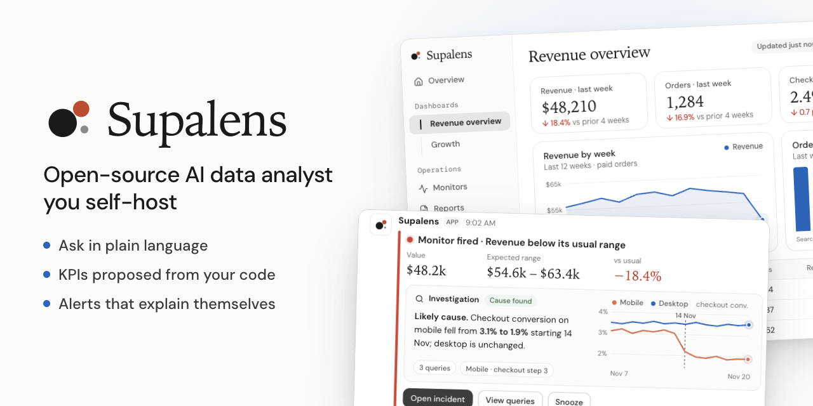
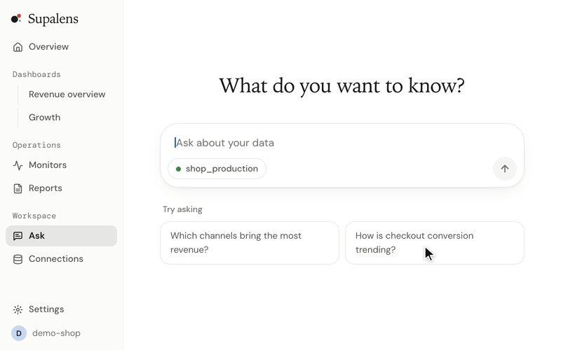

<p align="center">
  
</p>

<h1 align="center">Supalens</h1>

<p align="center">
  <a href="./README.md">English</a> · <a href="./README.ko.md">한국어</a> · <b>日本語</b> · <a href="./README.zh-CN.md">简体中文</a> · <a href="./README.es.md">Español</a>
</p>

<p align="center">
  <b>セルフホストできるオープンソースの AI データアナリスト。</b><br>
  Postgres を接続して普段の言葉で質問すると、スキーマとコードから KPI を提案し、<br>
  その数字を見守ります。数字が動いたら原因を調べて知らせます。
</p>

<p align="center">
  <a href="#クイックスタート">クイックスタート</a> ·
  <a href="./docs/self-hosting.md">セルフホスティングガイド(英語)</a> ·
  <a href="https://supalens.ai">ホスティング版</a>
</p>

<p align="center">
  <a href="./LICENSE"></a>
  
  
</p>

<p align="center">
  
</p>

## クイックスタート

```bash
git clone https://github.com/nullarch/supalens.git && cd supalens
./selfhost.sh
```

必要なのは **Docker と言語モデルの API キー**だけです。モデルは既定の Anthropic のほか、OpenAI
互換 API を提供する任意のプロバイダー、または Ollama で自分で動かすモデルも使えます。ほかに
アカウントを作る必要はなく、テレメトリーもなく、ブラウザーが外部サーバーを呼ぶこともありません。
スクリプトはアクセス先のアドレスとキーだけを尋ね、残りのシークレットを自動生成して、専用の
データベースとともにアプリを起動します。アドレスを開いて管理者アカウントを作成し、データベースを
接続してください。

> 初回起動時にアプリのイメージをローカルでビルドするため、Docker に約 6 GB のメモリが必要です。
> 詳細・アップグレード・バックアップ: [docs/self-hosting.md](./docs/self-hosting.md)。

## できること

- **データベースに質問する。** 普段の言葉の質問が、読める SQL、結果に合ったチャート、ダッシュボードに
  ピン留めできるウィジェットになります。
- **KPI を提案 — 実際に実行できたものだけ。** スキーマ(リポジトリを接続していればコードも)を読んで
  KPI を提案します。すべての提案は実際に実行されたクエリから生まれるため、動かない指標は一覧に
  載りません。
- **しきい値ではなく目標で監視。** 気にしていることを書くと、日次の系列とルールの下書きを作り、
  承認する前にそのルールが過去 90 日間でどう動いたかを示します。
- **理由を説明するアラート。** モニターが発火するとエージェントが調査し、考えられる原因を
  アラートに添えて Slack・Discord・メールに届けます。
- **手元の AI から使う。** 内蔵の MCP サーバーにより、Claude や Cursor などの MCP クライアントから
  データを照会し、ダッシュボードやモニターを作成できます。

データソース: PostgreSQL、MySQL、Supabase、Firestore。UI の言語: 英語、韓国語、日本語。

## なぜ別の BI ツールなのか

ダッシュボードは、前の四半期に思いついた質問に答えるものです。Supalens はその逆の仕事のために
作りました。アナリストのいない小さなチームで、誰かが数字を見ているべきなのに誰も見ていない、
という状況です。

| | 従来の BI ツール | text-to-SQL ライブラリ | Supalens |
|---|---|---|---|
| 答えを得る方法 | チャートを手で組む | 自分のアプリから呼ぶ | 質問すると SQL・チャート・ピン留め可能なウィジェット |
| 何を追うか | 自分で決める | 自分で決める | スキーマとコードから KPI を提案し、実行して検証 |
| 数字の監視 | 定期レポート、固定しきい値 | なし | 目標ベースのモニター、承認前にバックテスト |
| 数字が動いたら | 自分で調べる | なし | 調査して原因をアラートに添付 |
| AI クライアントから | 通常は不可 | それ自体が部品 | MCP サーバー内蔵 |
| 運用 | サーバーを運用する | 組み込む必要のあるライブラリ | コマンド 1 つ、スタック 1 つ |

**次の場合は向いていません。** 複数のウェアハウスにまたがるセマンティックレイヤー、数十の
コネクター、ピクセル単位で整えた埋め込みダッシュボードが必要なら、従来の BI ツールのほうが
適しています。

## セルフホストとホスティング

コードも機能も同じです。オープンソース版から外している機能はありません。

| | セルフホスト | [supalens.ai](https://supalens.ai) |
|---|---|---|
| 機能 | すべて | すべて |
| 質問・モニター・メンバー数の上限 | なし | プランによる |
| モデル | 選択可: Anthropic、OpenAI 互換 API、ローカルモデル | 含まれる |
| アカウント | 管理者が作成する内部アカウント、ワークスペースは 1 つ | サインアップ、複数ワークスペース |
| Supabase / GitHub / Slack アプリ | 任意 — 自分で登録 | すぐ使える |
| アップデートとバックアップ | 自分で | マネージド |

## 安全性の仕組み

- **構造的に読み取り専用。** クエリはガードを通ります。`SELECT` のみ、読み取り専用トランザクション、
  実行時間の上限、行数の上限、すべてのクエリを監査記録。
- **サンドボックス化されたエージェント。** モデルが呼べるのは明示された読み取り専用ツールだけです。
  シェル、ネットワーク、クローンしたリポジトリの外のファイルシステムには触れられません。どのモデル
  プロバイダーを使っても、データベースの認証情報がモデルに渡ることはありません。
- **暗号化された認証情報。** ワークスペースごとの鍵でエンベロープ暗号化します。
- **信頼しないコードは信頼しないまま。** 接続したリポジトリは読むだけで、ビルド・インストール・実行は
  しません。

脆弱性の報告: [SECURITY.md](./SECURITY.md)。

## さらに詳しく

アーキテクチャ、開発環境、コントリビューション方法は[英語版 README](./README.md#how-it-works) と
[CONTRIBUTING.md](./CONTRIBUTING.md) にあります。

## ライセンス

[AGPL-3.0-only](./LICENSE)。Claude Agent SDK への依存に関する追加の許諾は
[NOTICE.md](./NOTICE.md) に記載しています。Supalens の名称とロゴはコードのライセンスの対象外です —
[TRADEMARK.md](./TRADEMARK.md)。
