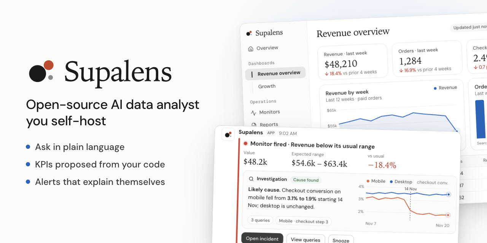
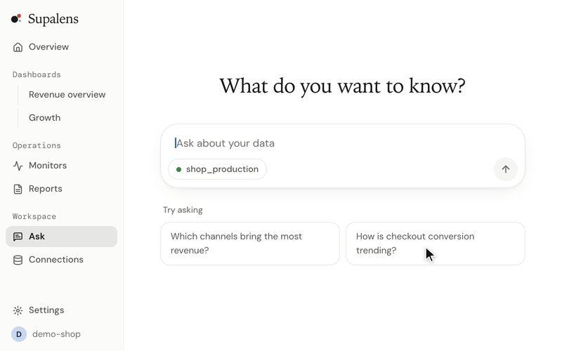

<p align="center">
  
</p>

<h1 align="center">Supalens</h1>

<p align="center">
  <a href="./README.md">English</a> · <b>한국어</b> · <a href="./README.ja.md">日本語</a> · <a href="./README.zh-CN.md">简体中文</a> · <a href="./README.es.md">Español</a>
</p>

<p align="center">
  <b>직접 설치해 쓰는 오픈소스 AI 데이터 분석가.</b><br>
  Postgres를 연결하고 평소 말로 질문하면, 스키마와 코드에서 KPI를 제안하고<br>
  그 숫자를 대신 지켜봅니다. 숫자가 움직이면 원인을 조사해 알려 줍니다.
</p>

<p align="center">
  <a href="#빠른-시작">빠른 시작</a> ·
  <a href="./docs/self-hosting.md">셀프호스팅 안내서 (영문)</a> ·
  <a href="https://supalens.ai">호스팅 버전</a>
</p>

<p align="center">
  <a href="./LICENSE"></a>
  
  
</p>

<p align="center">
  
</p>

## 빠른 시작

```bash
git clone https://github.com/nullarch/supalens.git && cd supalens
./selfhost.sh
```

필요한 것은 **Docker와 언어 모델 API 키** 두 가지뿐입니다. 모델은 기본값인 Anthropic, OpenAI 호환
API를 제공하는 어느 곳이든, 또는 Ollama로 직접 돌리는 모델도 됩니다. 따로 가입할 서비스가 없고,
원격 측정도 없으며, 브라우저가 외부 서버를 호출하지 않습니다. 스크립트가 접속 주소와 키만 묻고
나머지 비밀값은 자동으로 만든 뒤 자체 데이터베이스와 함께 앱을 띄웁니다. 주소를 열어 관리자 계정을
만들고 데이터베이스를 연결하면 끝입니다.

> 첫 실행 때 앱 이미지를 로컬에서 빌드하므로 Docker에 메모리 약 6GB가 필요합니다.
> 자세한 내용, 업그레이드, 백업: [docs/self-hosting.md](./docs/self-hosting.md).

## 하는 일

- **데이터베이스에 질문하기.** 평소 말로 물으면 읽을 수 있는 SQL, 결과에 맞는 차트, 대시보드에
  고정할 수 있는 위젯이 나옵니다.
- **KPI를 대신 제안 — 실제로 실행된 것만.** 스키마(레포를 연결했다면 코드까지)를 읽고 KPI를
  제안합니다. 모든 제안은 실제로 실행된 쿼리에서 나오므로, 돌아가지 않는 지표는 목록에 오르지
  않습니다.
- **임계값이 아니라 목표로 감시.** 무엇이 신경 쓰이는지 적으면 일별 추이와 규칙 초안을 만들고,
  승인하기 전에 그 규칙이 지난 90일 동안 어떻게 동작했을지 보여 줍니다.
- **스스로 설명하는 알림.** 모니터가 발동하면 에이전트가 조사해 유력한 원인을 알림에 붙여
  Slack, Discord, 이메일로 보냅니다.
- **쓰던 AI에서 그대로.** 내장 MCP 서버로 Claude, Cursor 등 MCP 클라이언트에서 데이터를 조회하고
  대시보드와 모니터를 만들 수 있습니다.

데이터 소스: PostgreSQL, MySQL, Supabase, Firestore. 화면 언어: 영어, 한국어, 일본어.

## 왜 또 다른 BI 도구인가

대시보드는 지난 분기에 떠올린 질문에 답합니다. Supalens는 그 반대의 일을 위해 만들었습니다.
분석가가 없는 작은 팀, 누군가 숫자를 지켜봐야 하는데 아무도 보고 있지 않은 상황입니다.

| | 기존 BI 도구 | text-to-SQL 라이브러리 | Supalens |
|---|---|---|---|
| 답을 얻는 방법 | 차트를 직접 구성 | 내 앱에서 호출 | 질문하면 SQL·차트·고정 가능한 위젯 |
| 무엇을 볼지 | 직접 정함 | 직접 정함 | 스키마와 코드에서 KPI 제안, 실행으로 검증 |
| 숫자 감시 | 예약 리포트, 고정 임계값 | 없음 | 목표 기반 모니터, 승인 전 백테스트 |
| 숫자가 움직이면 | 직접 조사 | 없음 | 조사해서 원인을 알림에 첨부 |
| AI 클라이언트에서 | 보통 불가 | 그 자체가 부품 | MCP 서버 내장 |
| 운영 | 서버를 직접 운영 | 직접 연결해야 하는 라이브러리 | 명령 한 줄, 스택 하나 |

**이런 경우에는 맞지 않습니다.** 여러 웨어하우스에 걸친 시맨틱 레이어, 수십 개의 커넥터,
픽셀 단위로 맞춘 임베디드 대시보드가 필요하다면 기존 BI 도구가 더 낫습니다.

## 셀프호스팅과 호스팅

코드도 기능도 같습니다. 오픈소스 버전에서 빼 둔 기능은 없습니다.

| | 셀프호스팅 | [supalens.ai](https://supalens.ai) |
|---|---|---|
| 기능 | 전부 | 전부 |
| 질문·모니터·멤버 수 제한 | 없음 | 요금제별 |
| 모델 | 선택: Anthropic, OpenAI 호환 API, 로컬 모델 | 포함 |
| 계정 | 관리자가 만드는 내부 계정, 워크스페이스 하나 | 가입, 여러 워크스페이스 |
| Supabase / GitHub / Slack 앱 | 선택 사항 — 직접 등록 | 바로 사용 |
| 업데이트와 백업 | 직접 | 관리형 |

## 안전하게 유지되는 방식

- **구조적으로 읽기 전용.** 쿼리는 가드를 거칩니다. `SELECT`만 허용, 읽기 전용 트랜잭션, 실행
  시간 제한, 행 수 제한, 모든 쿼리 감사 기록.
- **격리된 에이전트.** 모델은 명시된 읽기 전용 도구만 호출할 수 있습니다. 셸, 네트워크, 복제된
  레포 바깥의 파일 시스템에는 접근할 수 없습니다. 어떤 모델 공급자를 쓰든 데이터베이스 자격증명은
  모델에 전달되지 않습니다.
- **암호화된 자격증명.** 워크스페이스별 키로 봉투 암호화합니다.
- **신뢰하지 않는 코드는 그대로.** 연결한 레포는 읽기만 하고 빌드·설치·실행하지 않습니다.

취약점 신고: [SECURITY.md](./SECURITY.md).

## 더 보기

구조, 개발 환경, 기여 방법은 [영문 README](./README.md#how-it-works)와
[CONTRIBUTING.md](./CONTRIBUTING.md)에 있습니다.

## 라이선스

[AGPL-3.0-only](./LICENSE). Claude Agent SDK 의존성에 대한 추가 허용 조항은
[NOTICE.md](./NOTICE.md)에 있습니다. Supalens 이름과 로고는 코드 라이선스의 대상이 아닙니다 —
[TRADEMARK.md](./TRADEMARK.md).
