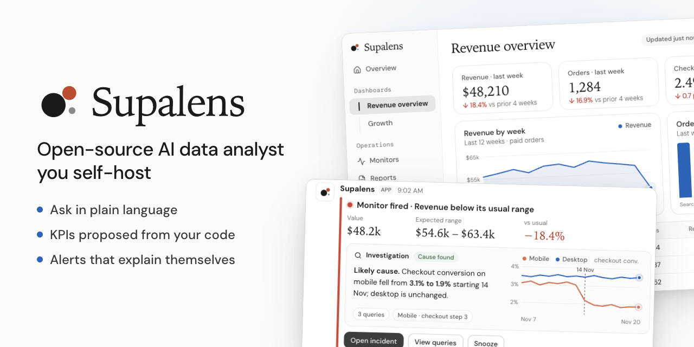
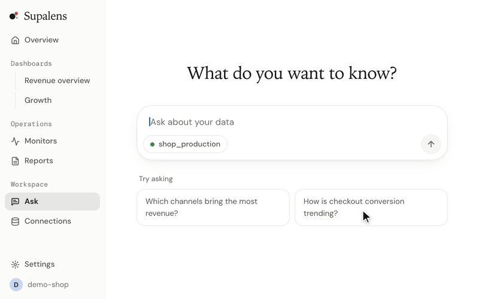

<p align="center">
  
</p>

<h1 align="center">Supalens</h1>

<p align="center">
  <b>English</b> · <a href="./README.ko.md">한국어</a> · <a href="./README.ja.md">日本語</a> · <a href="./README.zh-CN.md">简体中文</a> · <a href="./README.es.md">Español</a>
</p>

<p align="center">
  <b>Open-source AI data analyst you self-host.</b><br>
  Connect Postgres, ask in plain language, get KPIs proposed from your schema and code,<br>
  and let it watch them — when a number moves, it investigates and tells you why.
</p>

<p align="center">
  <a href="#quick-start">Quick start</a> ·
  <a href="./docs/self-hosting.md">Self-hosting guide</a> ·
  <a href="https://supalens.ai">Hosted version</a>
</p>

<p align="center">
  <a href="./LICENSE"></a>
  
  
</p>

<p align="center">
  
</p>

## Quick start

```bash
git clone https://github.com/nullarch/supalens.git && cd supalens
./selfhost.sh
```

You need **Docker and an API key for a language model** — Anthropic by default, or any
OpenAI-compatible provider, or a model you run yourself with Ollama. That is the whole list: no
other account to create, no telemetry, and the browser never calls a third party. The script asks
for the address and the key, generates every other secret, and starts the app with its own database. Open the address,
create the administrator account, connect a database.

> The first start builds the app image locally and needs about 6 GB of memory for Docker.
> Details, upgrades and backups: [docs/self-hosting.md](./docs/self-hosting.md).

## What it does

- **Ask your database.** Plain-language questions become SQL you can read, a chart chosen for the
  result, and a widget you can pin to a dashboard.
- **KPIs proposed for you — and only ones that ran.** Supalens reads your schema (and your
  repository, if you attach one) and proposes KPIs. Every proposal comes from a query that was
  actually executed, so nothing unrunnable reaches the list.
- **Monitor by goal, not threshold.** Describe what you care about; it drafts the daily series and
  the rule, and shows how that rule would have behaved over the last 90 days before you approve.
- **Alerts that explain themselves.** When a monitor fires, an agent investigates and attaches the
  likely cause to the alert, delivered to Slack, Discord or email.
- **Use it from your own AI.** A built-in MCP server lets Claude, Cursor and other MCP clients
  query your data, create dashboards and set up monitors.

Data sources: PostgreSQL, MySQL, Supabase, Firestore.

## Why another BI tool

Dashboards answer the questions you thought to ask last quarter. Supalens is built for the
opposite job: a small team with no analyst, where someone should be watching the numbers and
nobody is.

| | A classic BI tool | A text-to-SQL library | Supalens |
|---|---|---|---|
| Getting an answer | Build a chart by hand | Call it from your own app | Ask; get SQL, a chart and a pinnable widget |
| Knowing what to track | You decide | You decide | Proposes KPIs from schema and code, verified by running them |
| Watching the numbers | Scheduled reports, fixed thresholds | Not included | Goal-based monitors, backtested before you approve |
| When something moves | You investigate | Not included | Investigates and attaches the cause to the alert |
| From an AI client | Usually not | It is the building block | MCP server included |
| Running it | A server to operate | A library to wire up | One command, one stack |

**Skip Supalens if** you need a governed semantic layer across a warehouse fleet, dozens of
connectors, or pixel-perfect embedded dashboards — a classic BI tool does that better.

## Self-hosted or hosted

Same code, same features. Nothing is held back from the open-source edition.

| | Self-hosted | [supalens.ai](https://supalens.ai) |
|---|---|---|
| Features | All | All |
| Limits on questions, monitors, members | None | By plan |
| Model | Your choice: Anthropic, any OpenAI-compatible API, or a local model | Included |
| Accounts | Internal accounts created by an admin; one workspace | Sign up, multiple workspaces |
| Supabase / GitHub / Slack apps | Optional — register your own | Ready to use |
| Updates and backups | You | Managed |

## How it stays safe

- **Read-only by construction.** Queries go through a guard: `SELECT` only, read-only
  transaction, statement timeout, row cap, every query audited.
- **A sandboxed agent.** The model can only call an explicit list of read-only tools: no shell,
  no network, no file system outside a cloned repository. Database credentials never enter its
  context, whichever model provider you use.
- **Encrypted credentials.** Envelope encryption with a per-workspace key.
- **Untrusted code stays untrusted.** An attached repository is read, never built, installed or
  executed.

Report a vulnerability: [SECURITY.md](./SECURITY.md).

## How it works

| Layer | Technology |
|---|---|
| Web | Next.js 15 (App Router), React 19, TypeScript |
| Auth and application database | Supabase (Postgres with row-level security, GoTrue, PostgREST) |
| Agents | One tool loop, two providers: the Claude Agent SDK, or any OpenAI-compatible API |
| Background work | Built into the app when self-hosted; Trigger.dev on the hosted service |
| Charts | Recharts, driven by one declarative spec the agent writes and the UI renders |

The self-hosted stack is six containers behind one port: a gateway, the app, Postgres, auth,
PostgREST and a one-shot migration job. Design documents live in [`docs/`](./docs); `AGENTS.md` is
the short map of the codebase.

## Development

```bash
npm install
cp .env.example .env.local
npm run supabase:start
npm run dev
```

```bash
npx tsc --noEmit -p .
npm test
npm run lint
```

Contributions are welcome — see [CONTRIBUTING.md](./CONTRIBUTING.md).

## Licence

[AGPL-3.0-only](./LICENSE), with an additional permission for the Claude Agent SDK dependency
described in [NOTICE.md](./NOTICE.md). The Supalens name and logo are not covered by the code
licence — see [TRADEMARK.md](./TRADEMARK.md).
