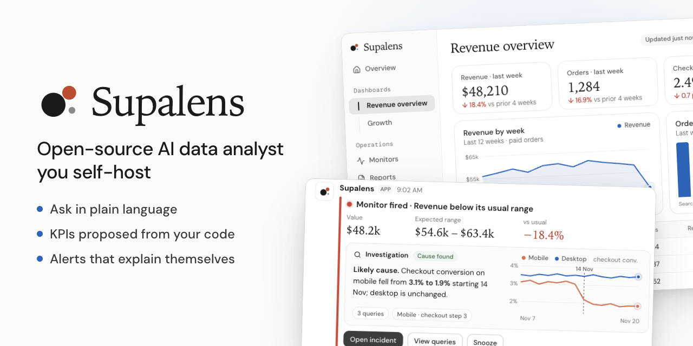
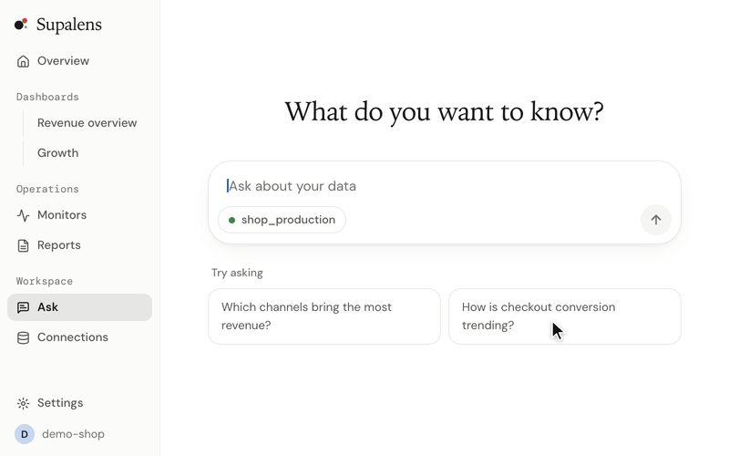

<p align="center">
  
</p>

<h1 align="center">Supalens</h1>

<p align="center">
  <a href="./README.md">English</a> · <a href="./README.ko.md">한국어</a> · <a href="./README.ja.md">日本語</a> · <b>简体中文</b> · <a href="./README.es.md">Español</a>
</p>

<p align="center">
  <b>可自托管的开源 AI 数据分析师。</b><br>
  连接 Postgres,用自然语言提问,它会根据你的表结构和代码提出 KPI,<br>
  并替你盯着这些指标——数字一有异动,就调查原因并告诉你。
</p>

<p align="center">
  <a href="#快速开始">快速开始</a> ·
  <a href="./docs/self-hosting.md">自托管指南(英文)</a> ·
  <a href="https://supalens.ai">托管版</a>
</p>

<p align="center">
  <a href="./LICENSE"></a>
  
  
</p>

<p align="center">
  
</p>

## 快速开始

```bash
git clone https://github.com/nullarch/supalens.git && cd supalens
./selfhost.sh
```

你只需要 **Docker 和一个大模型的 API 密钥**。模型默认使用 Anthropic,也可以是任何兼容 OpenAI
接口的服务商,或者用 Ollama 在本地运行的模型。除此之外不需要注册任何账号,没有遥测,浏览器也不会
请求第三方服务器。脚本只会询问访问地址和密钥,其余密钥全部自动生成,然后连同自带的数据库一起启动
应用。打开地址,创建管理员账号,连接数据库即可。

> 首次启动会在本地构建应用镜像,需要为 Docker 分配约 6 GB 内存。
> 详细说明、升级与备份:[docs/self-hosting.md](./docs/self-hosting.md)。

## 它能做什么

- **向数据库提问。** 自然语言问题会变成可读的 SQL、与结果相称的图表,以及可以固定到仪表盘的组件。
- **替你提出 KPI——而且只提出真正跑通的。** Supalens 读取你的表结构(如果关联了代码仓库,也会读取
  代码)并提出 KPI。每一条建议都来自实际执行过的查询,跑不通的指标不会出现在列表里。
- **按目标监控,而不是按阈值。** 描述你关心的事情,它会起草按天的序列和规则,并在你批准之前展示
  这条规则在过去 90 天里会如何表现。
- **会自己解释的告警。** 监控触发后,智能体会展开调查,把最可能的原因附在告警里,发送到 Slack、
  Discord 或邮箱。
- **在你自己的 AI 里使用。** 内置 MCP 服务器,Claude、Cursor 等 MCP 客户端可以直接查询数据、创建
  仪表盘和监控。

数据源:PostgreSQL、MySQL、Supabase、Firestore。界面语言:英语、韩语、日语(暂无中文界面)。

## 为什么还要一个 BI 工具

仪表盘回答的是你上个季度想到的问题。Supalens 是为相反的场景而做的:团队很小,没有分析师,本该有人
盯着数字,却没有人在看。

| | 传统 BI 工具 | text-to-SQL 库 | Supalens |
|---|---|---|---|
| 得到答案 | 手工搭建图表 | 在自己的应用里调用 | 提问即得 SQL、图表和可固定的组件 |
| 该跟踪什么 | 自己决定 | 自己决定 | 根据表结构和代码提出 KPI,并通过实际执行来验证 |
| 盯着数字 | 定时报表、固定阈值 | 不包含 | 基于目标的监控,批准前先回测 |
| 数字异动时 | 自己排查 | 不包含 | 调查并把原因附在告警里 |
| 从 AI 客户端使用 | 通常不行 | 它本身就是一块积木 | 内置 MCP 服务器 |
| 运行方式 | 需要运维一台服务器 | 需要自己接入的库 | 一条命令,一套栈 |

**以下情况不适合使用 Supalens:** 你需要跨多个数据仓库的受治理语义层、几十种连接器,或像素级精确
的嵌入式仪表盘——传统 BI 工具在这些方面做得更好。

## 自托管与托管版

代码相同,功能相同。开源版本没有保留任何功能。

| | 自托管 | [supalens.ai](https://supalens.ai) |
|---|---|---|
| 功能 | 全部 | 全部 |
| 提问、监控、成员数量限制 | 无 | 按套餐 |
| 模型 | 自选:Anthropic、任何兼容 OpenAI 的 API,或本地模型 | 已包含 |
| 账号 | 由管理员创建的内部账号,一个工作区 | 注册,多个工作区 |
| Supabase / GitHub / Slack 应用 | 可选——自行注册 | 开箱即用 |
| 更新与备份 | 自己负责 | 托管 |

## 如何保证安全

- **结构上只读。** 查询必须经过防护层:只允许 `SELECT`、只读事务、语句超时、行数上限,所有查询都有
  审计记录。
- **沙箱化的智能体。** 模型只能调用一份明确列出的只读工具:没有 shell,没有网络,无法访问克隆仓库
  之外的文件系统。无论使用哪家模型服务商,数据库凭据都不会进入模型的上下文。
- **凭据加密。** 使用每个工作区独立的密钥进行信封加密。
- **不可信的代码始终不可信。** 关联的代码仓库只会被读取,不会被构建、安装或执行。

报告安全漏洞:[SECURITY.md](./SECURITY.md)。

## 了解更多

架构、开发环境和贡献方式见[英文 README](./README.md#how-it-works) 与
[CONTRIBUTING.md](./CONTRIBUTING.md)。

## 许可证

[AGPL-3.0-only](./LICENSE)。针对 Claude Agent SDK 依赖的附加许可见 [NOTICE.md](./NOTICE.md)。
Supalens 的名称和标志不在代码许可证的范围内——见 [TRADEMARK.md](./TRADEMARK.md)。
